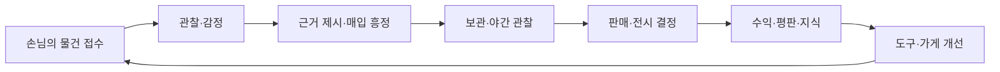

# 심야 골동품점 — 게임 기획서

버전 0.2 · 2026-11-24
플랫폼: Roblox · 콘셉트 검토 단계
제목·세계관·인물·수치는 제안이며 미확정

## 1. 한 줄 기획

**이상한 물건의 진짜 가치와 취급법을 밝혀내고, 흥정으로 매입해 나만의 골동품점을 키우는 감정·경영 게임.**

플레이어는 물건의 가격만 맞히는 사람이 아니다. 누구에게 팔아야 할지, 가게에 남겨야 할지, 위험을 감수할지 결정하는 상인이다.

핵심 재미는 ‘남들은 고물로 보는 물건에서 가치를 발견했다’와 ‘내 판단으로 거래를 잘했다’는 성취감이다. 공포는 물건을 조사하고 다루는 규칙에서 발생한다. 가게 운영만으로도 재미가 성립해야 한다.

## 2. No Umbrellas Allowed에서 참고할 것

개발사 Steam 소개에서 확인한 구조는 물건의 재질·브랜드·역사 등을 조사해 가치를 판단하고, 손님의 기대와 감정을 고려해 매입 가격을 협상한 뒤 진열·판매하는 것이다. 평판과 손님 취향도 거래에 영향을 준다. [개발사 공식 상품 소개](https://store.steampowered.com/app/1301390/No_Umbrellas_Allowed/)

우리 기획은 다음과 같이 발전시킨다. 아래는 참조작 기능 설명이 아닌 신규 설계다.

| 참고하는 재미 | 심야 골동품점의 구현 제안 |
|---|---|
| 관찰·지식으로 가치를 발견 | 3D 물건 회전, 확대, 도구 사용으로 단서 확인 |
| 정보에 근거한 가격 협상 | 발견한 사실을 제시해 상대의 판단을 바꾸는 짧은 흥정 |
| 취향에 맞는 손님에게 판매 | 일반 구매자·전문 수집가·사연 있는 의뢰인의 다른 수요 |
| 가게 성장과 물건의 역사 | 전시품이 새 손님·도구·작은 이야기를 연결 |

**독자적인 중심 장치:** 낮에 평가한 물건을 밤에 보관하면서 ‘현상과 취급 조건’을 알아낸다. 희귀한 물건도 잘못 다루면 수익이 나지 않고, 평범한 물건도 알맞은 구매자를 찾으면 가치가 생긴다.

참조작의 배경·서사·인물·UI·대사·아이템을 재현하지 않는다. 긴 매뉴얼 암기 대신 짧은 관찰과 근거 제시로 첫 거래를 시작하게 한다.

## 3. 플레이어 경험과 기본 구성

| 항목 | 권장안 |
|---|---|
| 주 장르 | 감정·상점 경영·수집 |
| 분위기 | 따뜻한 가게, 낯선 물건, 점진적인 기묘함 |
| 기본 모드 | 개인 가게에서 NPC와 거래 |
| 첫 버전 인원 | 1인. 공유 광장·방문은 후속 검토 |
| 지원 | PC·모바일, 모든 감정·흥정은 터치 가능 |
| 플레이 길이 | 가게의 하루 8~12분을 초기 목표로 시험 |
| 진행 방식 | 여러 날 누적 성장, 거래 사이 저장 |
| 언어 | 한국어 우선, 아이템·대사는 번역 가능한 데이터 |

플레이어를 계속 기다리게 하는 방치 수익이나 접속 시간 강요는 핵심으로 두지 않는다. 관찰·판단을 잘하면 같은 하루에 더 좋은 거래를 만들 수 있게 한다.

## 4. 핵심 순환

첫 버전에서는 손님이 물건을 가져온다. 외부 탐색·발굴까지 함께 만들지 않는다. 이후 경매·폐가 탐색은 매입 경로를 넓히는 확장 후보로 둔다.

### 하루 진행 예시

1. 개점: 오늘의 손님 요청과 예산 확인.
2. 매입: 물건 2~3개를 감정하고 살지 결정.
3. 판매: 전날 준비한 물건을 판매하거나 의뢰에 납품.
4. 폐점: 보관 위치를 정하고 새 물건의 짧은 현상 관찰.
5. 정산: 현금·재고·새 지식·다음 목표 확인 후 저장.

실제 거래 횟수와 길이는 테스트로 조정한다. 밤마다 강제 장편 이벤트가 나오지는 않는다.

## 5. 감정 시스템

### 물건 정보 4층

| 층 | 확인 내용 | 주된 행동 |
|---|---|---|
| 외관 | 균열, 각인, 재질, 수선 흔적 | 회전·확대·부분 선택 |
| 진위·연대 | 제작 방식과 도감의 일치 여부 | 짧은 자료 비교 |
| 현상 | 특정 상황의 움직임·소리·변화 | 도구·조건 시험 |
| 수요 | 어떤 구매자가 왜 원하는가 | 손님 요청·대화 확인 |

감정 결과는 ‘추정 / 확인 / 미확인’을 표시한다. 모든 비밀을 밝히지 않아도 매입할 수 있지만, 추정 가격 범위가 넓고 취급 비용을 예상하기 어렵다.

### 조작

물건 회전 → 관심 부위 선택 → 도구 사용 → 결과가 감정 카드에 기록된다. 첫 버전 도구는 확대경과 자외선등 두 가지다. 도감은 관련 항목을 자동으로 열며 정답을 통째로 표시하지 않는다.

### 난이도 원칙

- 결정적인 단서는 화면 크기나 청력에만 의존하지 않는다.
- 각인·흠집은 충분히 확대하고 소리 변화는 시각 신호를 병행한다.
- 중요한 결과는 같은 조건에서 재현된다. 감정 도중 숨겨진 무작위 실패는 없다.
- 새 분류의 물건은 먼저 안전한 사례로 규칙을 배운 뒤 응용한다.
- 도구가 비싸서 진위를 전혀 판단할 수 없는 거래는 초반에 만들지 않는다.

## 6. 가격과 흥정

### 가격은 하나의 정답이 아니다

물건의 기준 가치, 구매자의 취향, 상태, 출처의 신뢰도, 취급 부담을 분리한다. 초자연적 물건이라는 이유만으로 항상 비싸지는 않는다.

예시 개념식:

`구매자 평가 = 기준 가치 × 상태 계수 × 취향 계수 + 확인된 출처 가치 − 예상 취급 부담`

계수와 통화 수치는 테스트용 데이터로 조정하며 경제 모델의 검증 결과가 아니다. 플레이어에게는 숨겨진 정답 가격 대신 근거가 붙은 예상 범위를 보여준다.

### 흥정은 3회 내외의 짧은 판단

1. 손님의 희망 가격 확인.
2. 플레이어가 가격과 근거를 제안.
3. 손님이 역제안·수락·거절.
4. 수락하거나 마지막 제안, 또는 거래 종료.

근거는 발견한 사실만 사용할 수 있다. 예: ‘은도금이 벗겨져 수선 비용이 든다’, ‘도감과 각인이 일치한다’. 같은 사실의 반복 제시는 추가 효과가 없다.

손님은 예산·목표 가격·인내·관심사를 가진다. 거절 이유는 ‘예산 초과’, ‘수집 분야와 다름’, ‘가격 차이가 너무 큼’처럼 대화로 알린다. 감정 결과를 많이 클릭했다고 무조건 싸게 살 수 있는 구조는 피한다. 진품임을 입증하면 판매자의 요구가 오를 수도 있다.

### 거래 실패와 회복

거래를 거절하는 것도 정상 선택이다. 초반 손해는 다음 거래로 회복할 수 있어야 한다. 시작 자금 부족 시 소유권을 사지 않고 수수료를 받는 ‘감정 의뢰’를 제공한다. 부채·파산·재고 영구 소실은 첫 버전에 넣지 않는다.

## 7. 야간 현상과 취급 규칙

밤은 물건의 숨은 성질을 밝혀내는 시간이다. 플레이어가 관찰 위치와 보관 조건을 선택하면 짧은 사건이 발생한다.

| 물건 예시 | 관찰 단서 | 취급 조건 | 거래의 재미 |
|---|---|---|---|
| 발신자 없는 탁상전화 | 전원을 끊어도 종이 울림 | 기록 장치를 옆에 두면 메시지 보존 | 메시지의 주인을 찾는 의뢰와 연결 |
| 빛을 먹는 오르골 | 뚜껑을 열면 주변 조명이 약해짐 | 닫힌 진열함에서 안정 | 현상을 원하는 수집가, 밝은 매장을 원하는 손님의 다른 평가 |
| 돌아오는 나무새 | 매일 특정 표식 쪽으로 이동 | 이동 경로를 막지 않는 선반 | 각인과 방향을 대조해 제작 출처 발견 |

위 아이템은 제작 후보이며 첫 버전은 이 중 현상 1종부터 검증한다. 취급 규칙은 도구 결과나 안전한 첫 관찰로 예고한다. 처음 보는 규칙을 어겼다는 이유로 갑자기 물건을 잃게 하지 않는다.

공포 연출은 물건과 공간의 작은 변화에 집중한다. 추격 적 AI, 대규모 전투, 과도한 점프스케어는 첫 범위에서 제외한다. 현상 자체는 소리 없이도 이해 가능하게 한다.

## 8. 판매·전시·가게 성장

매입품은 바로 팔기, 추가 감정, 전시 중 선택한다. 전시는 재고를 현금으로 바꾸지 않는 대신 도감·인테리어 만족·관련 의뢰를 제공한다. 전시품을 희생해야만 성장하는 구조는 만들지 않는다.

가게 성장은 세 축이다.

- **도구:** 더 다양한 관찰 방법. 정답 자동 판독이 아니라 판단 재료 확장.
- **공간:** 더 많은 분류·배치·재고 관리 선택.
- **지식·평판:** 새로운 손님과 매입 품목 개방.

최초 확장은 구매 가능한 공간 하나만 제공한다. 직원 자동화·다층 건물·온라인 경매는 이후 검토한다.

## 9. 캐릭터와 스토리

장편 줄거리는 사용자가 정한다. 시스템은 스토리가 확정되지 않아도 작동하게 설계한다.

첫 캐릭터 기능은 다음 세 역할로 제한한다.

| 역할 | 기능 | 관계 장면 예시 |
|---|---|---|
| 옆 가게 수선공 | 수리와 손익 판단 안내 | 수리 흔적에서 이전 소유자를 알아봄 |
| 단골 수집가 | 선호 품목·고가 의뢰 | 늘 같은 종류만 모으는 이유가 드러남 |
| 이름을 남기지 않는 손님 | 야간 현상과 작은 미스터리 연결 | 팔았던 물건을 다시 사러 옴 |

일반 거래는 재조합 가능한 짧은 대화, 특별 의뢰는 수작업으로 작성한다. 모든 물건에 독립적인 장편 사연을 붙이지 않아도 된다.

## 10. 첫 10분 온보딩

| 목표 시간 | 플레이 | 확인할 경험 |
|---|---|---|
| 0~1분 | 첫 손님, 물건 회전 | 바로 만질 수 있다 |
| 1~3분 | 확대경으로 각인 확인 | 내가 단서를 발견했다 |
| 3~5분 | 근거 하나로 매입 협상 | 정보가 가격에 영향을 준다 |
| 5~7분 | 준비된 구매자에게 판매 | 손익이 이해된다 |
| 7~10분 | 다음 매입품의 이상 현상 | 다음 물건과 내일이 궁금하다 |

시간은 목표이며 실제 강제 제한이 아니다. 감정은 생각할 시간을 주고, 대사는 다시 볼 수 있게 한다.

## 11. 수익화 제안

가게와 도구에 대한 애착을 구매 동기로 삼는다. 핵심 감정 능력은 모든 플레이어가 얻을 수 있다.

| 후보 | 가치 | 첫 검증 여부 |
|---|---|---|
| 가게 외관·인테리어 테마 | 자신의 취향 표현 | 후보 |
| 도구·진열장 스킨 | 자주 보는 물건 꾸미기 | 후보 |
| 거래 완료 연출·포장 스타일 | 상점의 개성 | 후속 |
| 전시 전용 장식 공간 | 수익·손님 처리량에 영향 없는 꾸미기 | 후속 |

첫 테스트 상품은 외형 1~2종으로 제한한다. 정답 표시, 협상 강제 성공, 물건 회수, 랜덤 유료 골동품 뽑기는 초기 상품으로 삼지 않는다. 무료 외형과 충분한 기본 보관 공간을 먼저 제공한다.

매출 가능성과 순이익은 미검증이다. 실제 구매 전환·환전 후 수령액과 에셋 제작·업데이트·홍보 비용을 함께 확인한다.

## 12. 첫 시제품 범위

### 1단계: 재미 검증

- 가게 1개, 카운터·선반·보관 구역.
- 물건 기본형 5개, 총 데이터 변형 약 10개.
- 도구 2개, 손님 성향 3개.
- 매입 흥정·판매·현금·재고.
- 초자연적 현상 1종, 짧은 특별 의뢰 1개.
- 저장·이어하기, 모바일 감정 조작.

물건 10개의 전용 모델을 모두 만들기보다 기본형과 상태·각인을 조합한다. 현상도 아이템별 전용 시스템 대신 재사용 가능한 조건·효과로 관리한다.

### 2단계: 소규모 공개 전 확장

거래가 재미있다는 반응을 확인한 후 가게 확장 1회, 수리 선택, 특별 의뢰 추가, 외형 상품 소수와 분석 이벤트를 넣는다. 지인 플레이만으로 시장성을 확정하지 않는다.

### 제외 범위

플레이어 간 거래, 협동 감정, 실시간 경매, 도시 전체 탐험, 자유 입력 AI 손님, 추격전, 풀보이스, 긴 메인 시나리오.

## 13. 경제·구현 검증 원칙

- 현금 변화와 재고 이동은 서버에서 한 거래로 처리한다. 중복 클릭·재접속으로 복제되지 않게 한다.
- 상품 가격·구매 가능 여부·보상은 클라이언트 값을 신뢰하지 않는다.
- 같은 물건을 고정 경로로 무한 매입·즉시 되팔아 돈을 만드는 루프를 점검한다.
- 최소 판매 수요와 감정 의뢰로 초반 자금 회복 경로를 제공한다.
- 재접속 때 현재 거래가 중복 결제되거나 물건이 사라지지 않도록 상태를 저장한다.
- 평판은 불가역적인 벌점보다 손님 구성과 관계 변화를 설명하는 지표로 시작한다.

## 14. 테스트와 다음 결정

가장 먼저 확인할 것은 공포의 강도가 아니라 **감정과 흥정이 재미있는가**다.

1. 첫 매입 후 판매 이익을 스스로 설명하는가?
2. 단서를 발견했을 때 다음 가격 제안이 달라지는가?
3. 팔고 싶은 물건과 남기고 싶은 물건이 생기는가?
4. 안내 없이 두 번째 거래를 시작하는가?
5. 밤의 현상이 흥미로운가, 반복 작업으로 느껴지는가?

도입 이탈·첫 거래 완료·거절 이유·도구 사용·재고 체류·두 번째 거래·재방문을 기록한다. 협상이 재미없으면 물건 수를 늘리기 전에 반응·근거 효과·가격 안내를 수정한다.

### 우선 확정할 기획 선택

- 공포 강도: 기묘하고 귀여움 / 잔잔한 불안 / 강한 공포.
- 물건 취향: 현실 골동품 중심 / 기괴한 창작품 중심 / 혼합.
- 흥정 깊이: 빠른 거래 / 근거 중심 협상.

**권장 기본값:** 잔잔한 불안, 현실과 창작품 혼합, 짧은 근거 중심 협상. 전체 스토리를 정하기 전에 물건 하나로 ‘감정→흥정→판매→야간 현상’의 하루를 검증한다.
